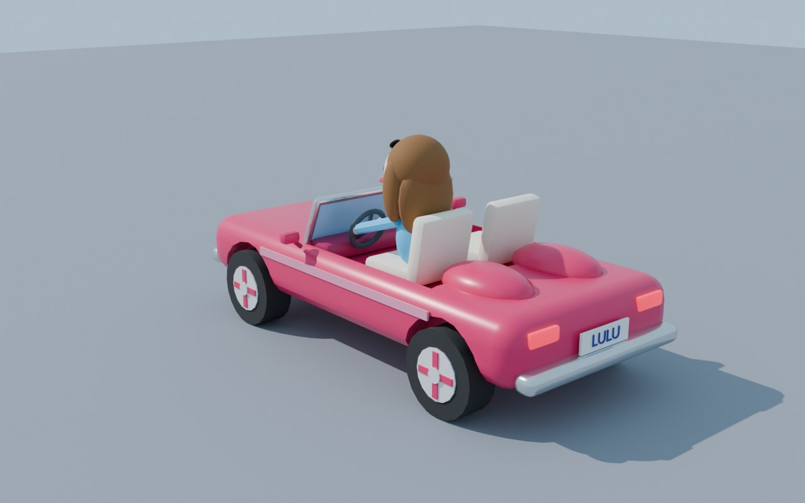

# Lulu's Road Trip 3D (beta)

**Play:** [lulu.boats/3d](https://lulu.boats/3d/) · works with a game controller, keyboard or touch.

A 3D take on the road trip: drive Lulu's convertible (with Lulu in it) down a
winding four-lane country road to **Bubbe's house**, about 3 miles away. Dodge
traffic and oncoming cars, grab coin trails (risky ones in the oncoming lane are
worth double), chain close calls to fill the nitro, honk slowpokes out of your
lane, and don't get flashed by the speed traps. After Bubbe's it's an endless cruise.

The car you picked in the 2D game's shop (Classic Pink, Racing Red…) shows up
here too, with the same handling stats. The 3D version only *reads* the 2D save;
its own progress lives in `localStorage["lulu3dSave"]`.

## Controls

| | Controller (Xbox · PlayStation · Switch Pro) | Keyboard | Touch |
|---|---|---|---|
| Steer | left stick (analog) / D-pad | ← → / A D | left thumb stick |
| Gas | RT · R2 · ZR (analog), or A | ↑ / W | GAS |
| Brake / reverse | LT · L2 · ZL (analog), or B | ↓ / S | BRAKE |
| Handbrake drift | X · □ · Y | Space | — |
| Nitro | RB · R1 · R | Shift | NITRO |
| Horn | LB · L1 · L | H | HONK |
| Camera (chase / far / Lulu's eyes) | Y · △ · X, or View | C | CAM |
| Look around / behind | right stick / click R3 | V (behind) | — |
| Pause | Start / Options / + | P / Esc | ❚❚ |

Menus work with the D-pad or stick plus A, or the arrow keys plus Enter. The
controller **rumbles** on crashes, rumble strips, grass and nitro, and the brake
trigger kicks under hard braking on Xbox impulse triggers. Rumble works in
Chrome and Edge; Safari doesn't expose it yet. Browsers don't count controller
buttons as a "user gesture", so sound starts after the first click, tap or key press.

## How it's built

No bundler: `index.html` loads ES modules straight from `js/`, plus a vendored
copy of three.js r170 (`vendor/three/`), so it runs offline and on GitHub Pages as-is.

| file | what |
|---|---|
| `js/main.js` | boot, game rules (hearts, coins, close calls, nitro, speed traps, arrival), camera rigs, screens, main loop |
| `js/car.js` | Lulu's car: arcade physics (grip, drift, off-road, impacts), suspension feel, wheels, skid marks, particles, nitro flames; skins shared with the 2D shop |
| `js/world.js` | the road (a bounded-heading spline that never loops), 200 m scenery chunks streamed ahead/recycled behind, trees/houses/poles/wires/signs, coins, speed traps, Bubbe's house + arch, sky, clouds |
| `js/traffic.js` | same-way and oncoming traffic: lane following, lane changes, honk reactions, headlight flashing, crash physics, near-miss detection |
| `js/input.js` | Gamepad API + keyboard + touch → one set of controls; rumble; per-controller button glyphs |
| `js/audio.js` | WebAudio engine (fake 5-speed gearbox), wind, tire squeal, horn, coins, crashes; music reuses `../luludriving.mp3` |
| `js/hud.js` | DOM HUD and controller-navigable menus |
| `js/models.js` | loads the `.glb`s, recolouring, wheel lookup, instancing |

### The 3D models come from Blender

Every model in `assets/` comes out of **`blender/make_assets.py`**, which builds
them all from code: the pink convertible with Lulu driving (sheitel, rosy cheeks,
shades on her head), sedans, minivans, a box truck, a cop car with a light bar,
round and pine trees, bushes, houses (with a mezuzah on every door), Bubbe's
yellow house with a picket fence, and Bubbe herself (with a waving arm). The
script also saves an editable **`blender/lulu_assets.blend`**.

```sh
blender -b -P 3d/blender/make_assets.py              # rebuild every .glb (+ the .blend)
blender -b -P 3d/blender/make_assets.py -- --render  # …and render blender/preview.jpg
# no Blender app?  pip install bpy  &&  python 3d/blender/make_assets.py
```

The game relies on these conventions: units are metres; the car's front is
Blender −Y; the wheels are objects named `Wheel_FL/FR/RL/RR` with their origin
at the hub; the steering wheel is its own object (`SteeringWheel`); and
materials are matched by name (`Body`/`BodyLight`/`BodyDark` take the skin
colour, `Paint` the traffic colour, `Walls`/`Roof` vary per house, and
`Headlight`/`Taillight`/`LightRed`/`LightBlue` are animated).



## Testing

`npm run smoke:3d` (`node scripts/smoke3d.js`; add `--shots` to save
screenshots to `smoke-shots/3d-*.png`) boots the page in headless Chromium
with software WebGL. It plugs in a fake Xbox controller and plays: it starts
from the menu with A, drives with RT and the stick, fires the nitro, switches
cameras, takes a head-on crash (checking for a lost heart and rumble), pauses
with Start, and drives under Bubbe's arch. In `?test` mode the game advances a
fixed 1/30 s per frame, so the test is deterministic even at a few fps.
