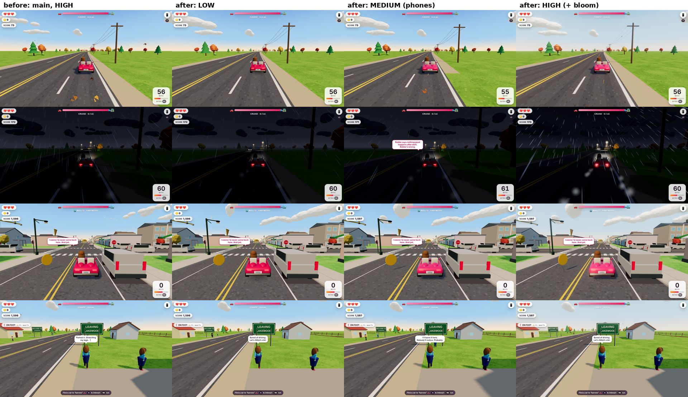

# ⚡ Graphics & performance — before / after (`ci/gfx`, 2026-11-19)

Measured with `node scripts/perf3d.js` (`scripts/tests3d/perf.js`) at 1280×720 in the cloud container's
**software** WebGL (SwiftShader), main (`bd0d973` + heist) vs. this branch, one tier at a time
(`PERF3D_TIER`). Software GL is slow and noisy — compare draw calls and triangles first; frame ms
are ±10 % run to run, and a scene's content (an extra e-bike rider in town, where the party
convoy is) varies a little between runs. The party row is two real pages on one machine: noisiest.

*Top to bottom: busy Cruise at noon, a storm at night, Lakewood's Main St, on foot by the road.
LOW has no real shadows (soft blobs under the cars), MEDIUM is what phones get on AUTO, HIGH adds
the bloom (lights / neon / tail lights glow) on desktops with a real GPU.*

## What changed for the player
* **Fewer draw calls everywhere on the highway** (−25 … −40 %): a road chunk's trees, bushes,
  houses and power poles are baked into a few merged meshes; far traffic cars become one mesh.
  Draw calls are what costs a phone's CPU in WebGL.
* **No memory creep on long drives:** road-sign textures are freed with their chunks (main leaked
  ~1 sign texture per 100 m: 11–12 on a 1.2 km drive).
* **⚙️ Settings → 🖼️ Graphics: AUTO / HIGH / MEDIUM / LOW** (saved in the 3D save). AUTO picks
  from the device and then holds 60 fps: it lowers the resolution first, then steps down a tier for
  the session; a 30 fps-capped phone (Low Power Mode) is left alone. AUTO never starts a phone at
  more pixels than main did (MEDIUM ≤ 1.5×).
* Looks: soft contact shadows, trees sway in the wind (harder in a storm), car paint and the wet
  road reflect the sky (MEDIUM / HIGH), the sun's shadow edges no longer shimmer, bloom on HIGH.

**LOW** (main → this branch)

| scene | draw calls | triangles | frame ms (software GL) | JS ms / frame |
|---|---|---|---|---|
| cruise | 319 → 197 (-38 %) | 76239 → 75694 (-1 %) | 225 → 216 (-4 %) | 4.4 → 5.1 (+17 %) |
| rain | 345 → 225 (-35 %) | 85184 → 84350 (-1 %) | 205 → 199 (-3 %) | 4.9 → 5.0 (+2 %) |
| rest | 364 → 254 (-30 %) | 152336 → 153577 (+1 %) | 332 → 327 (-1 %) | 5.4 → 4.9 (-8 %) |
| town | 193 → 185 (-4 %) | 113118 → 114057 (+1 %) | 293 → 274 (-6 %) | 4.4 → 4.0 (-10 %) |
| foot | 385 → 263 (-32 %) | 186352 → 185334 (-1 %) | 314 → 289 (-8 %) | 5.2 → 4.1 (-21 %) |
| interior | 170 → 167 (-2 %) | 53888 → 53214 (-1 %) | 377 → 365 (-3 %) | 2.9 → 3.0 (+4 %) |
| party | 119 → 130 (+9 %) | 36672 → 47301 (+29 %) | 354 → 404 (+14 %) | 4.1 → 5.2 (+27 %) |

main long drive: 1128 m · geometries 689 → 779 · textures 29 → 35 · materials 233 → 403 · heap 37.2 → 40.8 MB  
leak tracker (left the scene, never disposed): mat Mesh · MeshStandardMaterial ×15, tex Mesh · 1009 ×11, mat Scene/Sedan/Sedan_body/Sedan_body_4 · Headlight ×5, mat Scene/Sedan/Sedan_body/Sedan_body_1 · Paint ×4, mat Scene/NpcWoman/Arm_L002/Arm_L002_1 · Top ×2, mat Scene/NpcWoman/Body002/Body002_8 · Hair ×2

branch long drive: 933 m · geometries 706 → 823 · textures 25 → 26 · materials 250 → 381 · heap 37.4 → 41.1 MB  
leak tracker (left the scene, never disposed): mat chunk · MeshStandardMaterial ×10, tex chunk · 1009 ×6, geo Scene/lodFar ·  ×6, mat Scene/Sedan/Sedan_body/Sedan_body_4 · Headlight ×4, mat Scene/Sedan/Sedan_body/Sedan_body_1 · Paint ×3, mat Scene/NpcMan/Arm_L003/Arm_L003_1 · Top ×2

**MEDIUM** (main → this branch)

| scene | draw calls | triangles | frame ms (software GL) | JS ms / frame |
|---|---|---|---|---|
| cruise | 323 → 195 (-40 %) | 76495 → 75581 (-1 %) | 315 → 323 (+3 %) | 5.2 → 4.6 (-12 %) |
| rain | 345 → 222 (-36 %) | 87030 → 85930 (-1 %) | 407 → 373 (-8 %) | 9.6 → 6.6 (-31 %) |
| rest | 371 → 280 (-25 %) | 154152 → 156013 (+1 %) | 575 → 474 (-18 %) | 9.5 → 6.2 (-35 %) |
| town | 193 → 185 (-4 %) | 114260 → 114096 (0 %) | 425 → 483 (+13 %) | 5.4 → 5.8 (+7 %) |
| foot | 347 → 262 (-24 %) | 179060 → 182484 (+2 %) | 451 → 468 (+4 %) | 6.2 → 6.3 (+2 %) |
| interior | 169 → 170 (+1 %) | 53688 → 53904 (0 %) | 606 → 569 (-6 %) | 4.4 → 3.7 (-16 %) |
| party | 331 → 277 (-16 %) | 80310 → 84599 (+5 %) | 539 → 573 (+6 %) | 8.4 → 7.3 (-13 %) |

main long drive: 1146 m · geometries 718 → 874 · textures 33 → 40 · materials 230 → 432 · heap 38.2 → 43.2 MB  
leak tracker (left the scene, never disposed): mat Mesh · MeshStandardMaterial 512×256 #ffffff ×4, tex Mesh · 1009 512×256 ×4, mat Scene/Sedan/Sedan_body/Sedan_body_4 · Headlight #fff8e1 ×4, mat Mesh · MeshStandardMaterial #ffffff ×3, mat Scene/Truck/Truck_body/Truck_body_6 · Headlight #fff8e1 ×3, mat Mesh · MeshStandardMaterial 512×280 #ffffff ×2

branch long drive: 1152 m · geometries 718 → 779 · textures 30 → 32 · materials 241 → 324 · heap 37.8 → 40.9 MB  
leak tracker (left the scene, never disposed): mat Scene/Sedan/Sedan_body/Sedan_body_4 · Headlight #fff8e1 ×4, mat chunk · MeshStandardMaterial #ffffff ×3, geo Scene/lodFar · BufferGeometry ×3, mat Scene/Sedan/Sedan_body/Sedan_body_1 · Paint #66bb6a ×1, geo chunk/Scene/Bush/Canopy002 · BufferGeometry ×1, mat chunk/Scene/Bush/Canopy002 · Leaves #6cc24a ×1

**HIGH** (main → this branch)

| scene | draw calls | triangles | frame ms (software GL) | JS ms / frame |
|---|---|---|---|---|
| cruise | 326 → 204 (-37 %) | 76825 → 73669 (-4 %) | 316 → 568 (+80 %) | 6.2 → 4.9 (-22 %) |
| rain | 348 → 241 (-31 %) | 90200 → 90035 (0 %) | 305 → 582 (+91 %) | 5.5 → 6.3 (+16 %) |
| rest | 369 → 343 (-7 %) | 153712 → 168748 (+10 %) | 483 → 734 (+52 %) | 7.7 → 7.0 (-9 %) |
| town | 193 → 185 (-4 %) | 114354 → 109666 (-4 %) | 442 → 732 (+66 %) | 5.5 → 6.2 (+13 %) |
| foot | 387 → 264 (-32 %) | 189668 → 176622 (-7 %) | 469 → 698 (+49 %) | 6.0 → 6.7 (+11 %) |
| interior | 169 → 168 (-1 %) | 53643 → 53444 (0 %) | 566 → 856 (+51 %) | 3.4 → 4.2 (+23 %) |
| party | 258 → 260 (+1 %) | 70544 → 83275 (+18 %) | 504 → 823 (+63 %) | 6.7 → 10.4 (+57 %) |

main long drive: 1292 m · geometries 718 → 833 · textures 33 → 38 · materials 229 → 415 · heap 37.9 → 41.7 MB  
leak tracker (left the scene, never disposed): mat Mesh · MeshStandardMaterial ×16, tex Mesh · 1009 ×12, mat Scene/Sedan/Sedan_body/Sedan_body_4 · Headlight ×2, mat Scene/Van/Van_body/Van_body_1 · Paint ×2, mat Scene/Van/Van_body/Van_body_4 · Headlight ×2, mat Scene/NpcWoman/Arm_L002/Arm_L002_1 · Top ×2

branch long drive: 1283 m · geometries 772 → 917 · textures 35 → 38 · materials 243 → 443 · heap 38.5 → 43.6 MB  
leak tracker (left the scene, never disposed): mat chunk · MeshStandardMaterial ×10, tex chunk · 1009 ×6, mat Scene/Sedan/Sedan_body/Sedan_body_4 · Headlight ×3, mat Scene/NpcMan/Arm_L003/Arm_L003_1 · Top ×2, mat Scene/NpcMan/Body003/Body003_2 · Bottom ×2, mat Scene/NpcMan/Body003/Body003_8 · Hair ×2

## Reading the numbers
* **HIGH's frame ms go up in software GL** (e.g. cruise 316 → 568 ms): that's the bloom — an HDR,
  multisampled render target plus ~12 small passes, which SwiftShader does on the CPU. On a real
  desktop GPU it's a few % of a frame. It's why `?test` runs leave bloom off unless they opt in with
  `&enable=bloom` (only `gfx` and `perf` do); without bloom HIGH costs about what MEDIUM does.
* **MEDIUM vs main's MEDIUM** (what phones get): draw calls −16 … −40 %, frame time equal or faster
  except town (+13 % in that run; a repeat measured +9 %, ~20 ms of which are the paint reflections
  — software GL shades every reflective pixel on the CPU; one extra e-bike rider on screen made the rest).
* **LOW vs main's LOW**: draw calls −30 … −38 % on the highway, frame time equal or faster in
  every solo scene.
* **Leak tracker leftovers** are not growth: `geo Scene/lodFar` are the far-car meshes, cached once
  per model × paint and shared; `Headlight` / `Paint` are pooled traffic cars; the `chunk`
  128×256 / 8×64 / 256×256 textures are the rest areas' ramp / dash / lot materials, built once
  and reused by every exit. The perf test fails on > 30 geometries / > 40 materials / > 6 textures.

## 🕎 Seasons (`ci/seasons`, 2026-11-19) — the world dressed for Chanukah night 8

`node scripts/perf3d.js` at MEDIUM, scenes cruise / rain / town / foot, main vs. the branch with the world dressing on
(`PERF3D_ADD=seasons PERF3D_QUERY="&seasonDate=2026-12-11T19:00"` — the real calendar path pinned to the 8th night, so
only the world dressing is measured, not meta's car menorah):

| scene | draw calls | triangles | JS ms / frame | geometries |
|---|---|---|---|---|
| cruise | 196 → 196 | 75123 → 74271 (−1 %) | 5.31 → 4.96 | 268 → 298 |
| rain (night) | 216 → 220 (+2 %) | 83127 → 82816 | 6.11 → 6.2 | 310 → 356 |
| town (Main St) | 192 → 190 | 107440 → 110310 (+3 %) | 6.16 → 5.52 | 464 → 515 |
| foot | 305 → 288 | 151535 → 146887 | 6.21 → 6.43 | 436 → 469 |

(Traffic in view swings the totals by more than the dressing does.) What the dressing itself draws, from the `seasons`
test on a Lakewood street at night (`ctx.seasons.info().stats`): Chanukah night 8 = 6 draw calls (menorahs, the big
menorah, the stall, its goods, 2 light layers), 3.9k triangles, 620 menorahs / 5.6k candle lights in the town;
Sukkos = 2 draw calls, 6.1k triangles. A decorated Lakewood: 198 calls / 106k triangles (ceilings 240 / 115k).
Side note: meta's car menorah (the existing Chanukah car decoration, 9 flame sprites + a multi-material model)
costs ~30 draw calls on its own (`?holiday=chanukah&holidayDay=8`: cruise 196 → 229) — worth merging some day.
